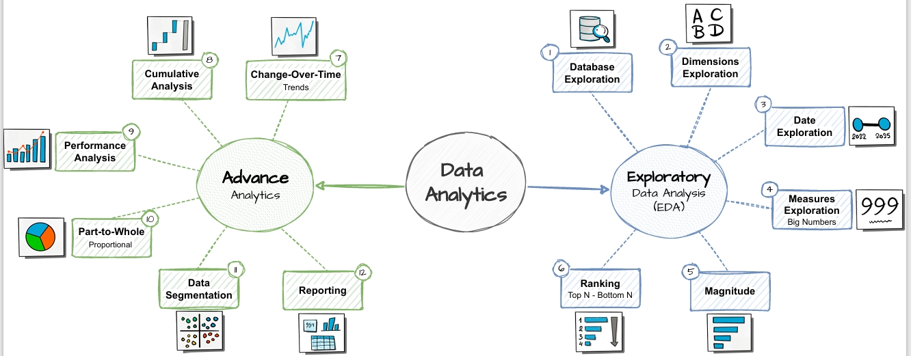

# SQL Data Analytics Project

A collection of SQL scripts demonstrating practical data exploration, analytical querying, and reporting techniques for relational datasets.

## Analysis Areas

- **Database Exploration:** Inspecting database structures, tables, and available data.
- **Measures & Metrics:** Calculating business metrics and summary measures.
- **Time-Based Analysis:** Exploring trends and changes over time.
- **Cumulative Analysis:** Building running totals and cumulative metrics.
- **Segmentation:** Grouping data to compare customers, products, or other dimensions.
- **Reporting Queries:** Structuring SQL outputs to support business reporting.

## Skills Demonstrated

- Writing and organizing SQL queries for analytical tasks.
- Exploring relational databases and understanding data structures.
- Aggregation, grouping, and metric calculation.
- Time-based and cumulative analysis.
- Data segmentation and reporting logic.

## Roadmap

## Tools & Technologies

SQL · Relational Databases · Data Exploration · Business Analytics · Reporting

## About

Created by **Mohammed Abdo Al Kareem Abalan** as part of a practical portfolio focused on SQL analytics and business intelligence.
